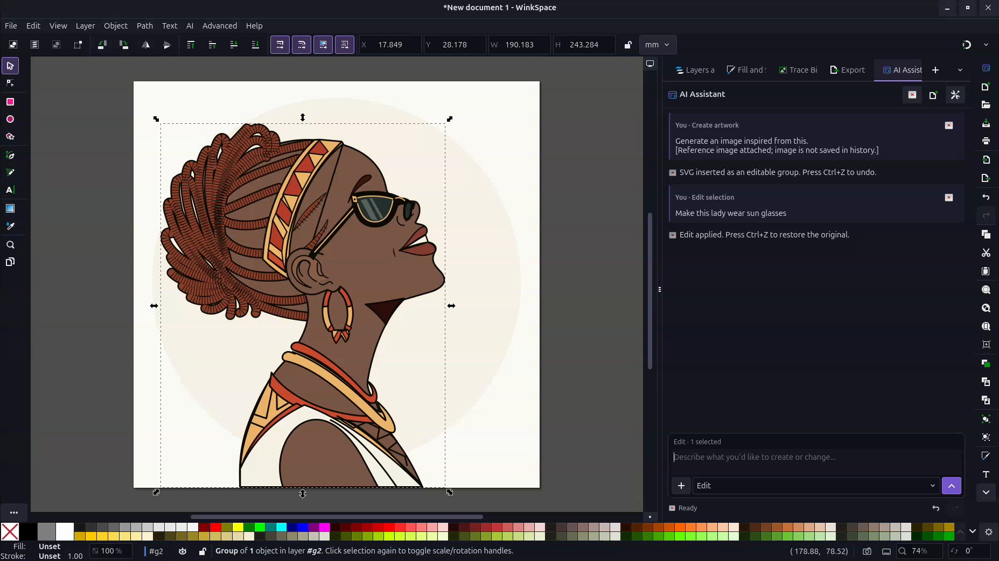
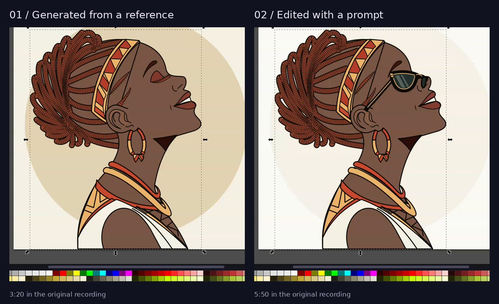
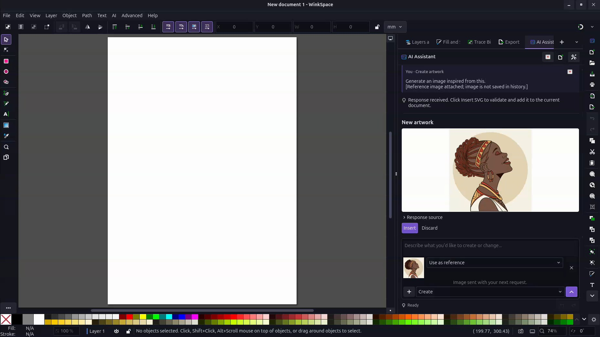
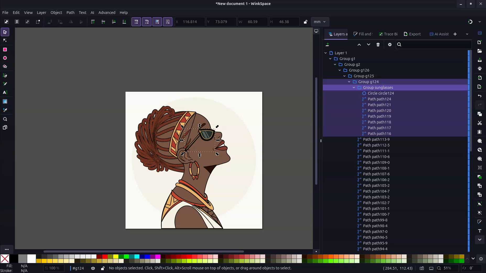

<p align="center">
  
</p>

<p align="center">
  <a href="https://github.com/Namandeepsd/winksopac/releases/tag/v0.1.0-beta.1"></a>
  <a href="#the-demo"></a>
  <a href="COPYING"></a>
</p>

<p align="center">
  <a href="https://github.com/Namandeepsd/winksopac/releases/download/v0.1.0-beta.1/winkspace_0.1.0-beta.1_amd64.deb"><strong>Download for Linux</strong></a>
  &nbsp; · &nbsp;
  <a href="https://github.com/Namandeepsd/winksopac/releases/download/v0.1.0-beta.1/winkspace-demo.mp4"><strong>Watch the demo</strong></a>
  &nbsp; · &nbsp;
  <a href="#get-started">Get started</a>
  &nbsp; · &nbsp;
  <a href="#build-from-source">Build from source</a>
</p>

# WinkSpace

WinkSpace brings an AI assistant into a vector editor. Describe a design, attach
a reference, and review the generated SVG before inserting it. Refine selected
artwork with another prompt, then keep working with its paths, groups, and the
rest of Inkscape's editing tools.

[](https://github.com/Namandeepsd/winksopac/releases/download/v0.1.0-beta.1/winkspace-demo.mp4)

<p align="center"><em>A real frame from the creator's demo. Click the image for the full recording.</em></p>

## The demo

The recording follows one illustration through generation and editing. A
reference image becomes a detailed vector portrait. The instruction
**"Make this lady wear sun glasses"** adds sunglasses, and the object tree shows
their group and individual paths.



| Generate and review | Inspect and keep editing |
| :---: | :---: |
| [](doc/media/generation-preview.jpg) | [](doc/media/editable-paths.jpg) |
| **3:00** · Preview the artwork before Insert | **6:20** · Inspect the generated paths |

[Watch or download the full demo](https://github.com/Namandeepsd/winksopac/releases/download/v0.1.0-beta.1/winkspace-demo.mp4)
· MP4 · 6 min 29 sec · recorded 14 November 2026.
[Screenshot details and extraction script](doc/media/README.md).
The recording predates this release, so some interface details can differ.

## What you can do

| Workflow | What it does |
| --- | --- |
| **Create** | Generate editable SVG from a text prompt, optionally with an image reference. |
| **Edit** | Refine selected artwork using natural language. Review the proposal before applying it. |
| **Generate inside selection** | Fill a closed shape with new artwork, using a locally constructed clip that preserves its outline and holes. |
| **Plan** | Develop a structured design brief and section layout, discover source-backed assets, then create a drawing preview. |
| **Commands** | Request supported native editor operations through the assistant. |
| **Keep editing** | Use paths, nodes, layers, text, fills, export, and native Undo/Redo in the vector editor. |

AI generation uses a model connection you configure. Supported options include
Codex, Claude Code, Kimi, Ollama, LM Studio, compatible APIs, and a custom CLI
bridge. Image references need a model that accepts image input.
[Connection setup](doc/ai-connections.md).

## Download Linux

**0.1.0 Beta 1 · x86_64 / amd64 · built and tested on Ubuntu 25.10 · GTK4**

| Download | Use it for |
| --- | --- |
| [**Ubuntu `.deb`**](https://github.com/Namandeepsd/winksopac/releases/download/v0.1.0-beta.1/winkspace_0.1.0-beta.1_amd64.deb) | Recommended on the tested Ubuntu release. APT installs the required system packages. |
| [Linux `.tar.xz`](https://github.com/Namandeepsd/winksopac/releases/download/v0.1.0-beta.1/WinkSpace-0.1.0-beta.1-linux-x86_64.tar.xz) | Extract and run on a system with compatible libraries. Includes a runtime dependency installer. |
| [Complete source `.tar.xz`](https://github.com/Namandeepsd/winksopac/releases/download/v0.1.0-beta.1/WinkSpace-0.1.0-beta.1-source.tar.xz) | Matching source, build scripts, and every initialized submodule. |
| [SHA256 checksums](https://github.com/Namandeepsd/winksopac/releases/download/v0.1.0-beta.1/SHA256SUMS) · [Build information](https://github.com/Namandeepsd/winksopac/releases/download/v0.1.0-beta.1/BUILD-INFO.json) | Verify downloads and inspect the source revision and build platform. |

These are native Linux builds with system library dependencies. Compatibility
with other distributions or older Ubuntu releases has not been established.
WinkSpace is beta software; generated results depend on the chosen model and
should be reviewed before applying them.

## Get started

### 1. Install and launch

Run this in a directory where you want to save the installer:

```bash
curl -fL -o winkspace_0.1.0-beta.1_amd64.deb \
  https://github.com/Namandeepsd/winksopac/releases/download/v0.1.0-beta.1/winkspace_0.1.0-beta.1_amd64.deb
sudo apt install ./winkspace_0.1.0-beta.1_amd64.deb
winkspace
```

The package also adds a **WinkSpace** application launcher. See the
[Linux guide](packaging/winkspace/README.md) for archive instructions,
dependencies, and removal.

### 2. Connect a model

Open **AI → AI Assistant**, then its **Connection settings**. Choose a connector,
complete its terminal login or API setup, and select a model. Use **Test
connection** to check a response. That test may use provider credits.
[Full setup instructions](doc/ai-connections.md).

### 3. Create, review, and refine

Choose **Create**, describe your design, and optionally attach an image using
**Use as reference**. Send the request, inspect the preview, and choose **Insert**.
Select artwork, switch to **Edit**, and describe a change. You can continue with
the regular vector tools and use **Ctrl+Z** to undo an insertion or edit.

Detailed artwork can take several minutes. Adjust **Request time limit
(minutes)** in Connection settings if needed. Online connectors send the request
and any included reference or artwork context to the selected provider. Local
inference requires a local model/server; a terminal login alone does not make
the model run offline.

The current GTK4 build shares Inkscape-format preferences unless you set a
separate `INKSCAPE_PROFILE_DIR`. Saved panel layouts are respected.

## Build from source

Use a recent Linux development environment with CMake, Ninja, a C++20 compiler,
GTK4/gtkmm4, and the required libraries. See the
[Linux build guide](packaging/winkspace/README.md#build-from-source) for packages
and minimum toolkit versions.

```bash
git clone --recurse-submodules https://github.com/Namandeepsd/winksopac.git WinkSpace
cd WinkSpace
cmake -S . -B build -G Ninja -DCMAKE_BUILD_TYPE=Release \
  -DCMAKE_INSTALL_PREFIX="$PWD/build/install_dir" \
  -DWINKSPACE_BUNDLE_LEARNING_RESOURCES=OFF \
  -DWINKSPACE_INSTALL_UPSTREAM_DESKTOP_ENTRIES=OFF
cmake --build build -j2
cmake --install build
./build/install_dir/bin/winkspace
```

The release source archive includes submodules. GitHub's automatically generated
source archives do not include their contents; use the attached complete source
archive or clone recursively.

## Project notes

- [AI connections](doc/ai-connections.md) · [Assistant guide](doc/ai-assistant-ui.md)
- [Planning and workflows](doc/ai-workflows.md) · [Native commands](doc/ai-commands.md)
- [Layout solver, evaluation, and limitations](doc/ai-report-evidence.md)
- [Linux packaging and verification](packaging/winkspace/README.md#release-verification)
- [Report a WinkSpace issue](https://github.com/Namandeepsd/winksopac/issues)

The demo establishes a working generation and editing example. Offline tests
cover workflow scheduling, layout search, connectors, SVG handling, asset
placement, shape clipping, and Undo/Redo. They do not establish a general visual
quality score, speed improvement, or success rate across models.

## Built on Inkscape

WinkSpace is an independent modified distribution of
[Inkscape](https://inkscape.org/). Its contribution is the integrated assistant,
workflows, and application presentation. The vector editor builds on the work of
Inkscape and its contributors; WinkSpace is not an official Inkscape release.

The combined application is distributed under **GPL-3.0-or-later**, with
component-specific notices retained. See [COPYING](COPYING),
[distribution notices](WINKSPACE-NOTICES.txt), [AUTHORS](AUTHORS),
[TRANSLATORS](TRANSLATORS), and [LICENSES](LICENSES/). Credits and licenses are
also available under **Help → About WinkSpace**.

[Upstream project information](doc/inkscape-upstream.md) ·
[Upstream learning resources](https://inkscape.org/learn/) ·
[Developer documentation](doc/readme.md)
