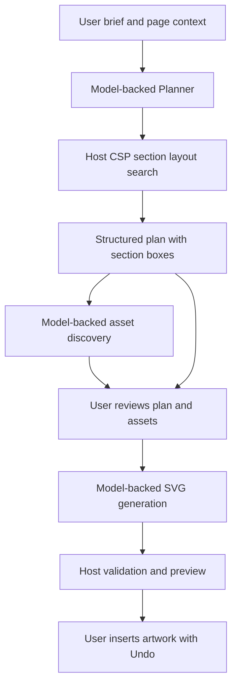

# WinkSpace: AI report evidence

Working title: **WinkSpace: A Human-Guided AI Vector Design Assistant with
Constraint-Based Layout Planning**.

This is an evidence outline, not the institution's final report template.

## Problem and objectives

Users must translate design intentions into vector geometry, source assets and
repeated editing operations. WinkSpace augments that process with model-assisted
planning, source-backed asset discovery and editable artwork proposals inside
Inkscape. Users inspect and accept proposals using the editor's existing preview
and Undo mechanisms. Evaluate whether this reduces effort while preserving
editability and user control; do not claim measured improvements without trials.

## Rubric mapping

| Topic | Implemented evidence | Explanation |
| --- | --- | --- |
| Problem statement | Plan/Create/Edit/Commands workflows | Natural-language assistance for vector design |
| State-space search | `src/ai/layout-search.cpp` | Partial rectangle assignments, assignment actions, complete feasible goal; depth-first backtracking with MRV and forward checking |
| Knowledge representation | `workflow-types.h`, `context-manager`, structured plans | Explicit section descriptions, palettes, geometry, scoped JSON knowledge, dependencies and provenance used by agents |
| Intelligent system design | Planner, Asset Discovery, orchestrator, preview bridge | Specialized model-backed agents coordinated by conventional host software |
| CSP | `layout-search.h`, Planner integration | Section variables, finite rectangle domains, unary boundary constraints, binary spacing/non-overlap; grid alignment encoded in domains |
| Other AI techniques | Injected model transport and prompts | Pretrained language/vision-model inference; no claim of training a new neural network |
| Ethics | Source metadata, bounded requests, user review | Attribution/licensing visibility, privacy implications of provider requests, generated-content errors and user agency |

CSP is the selected alternative to fuzzy logic. Fuzzy inference is not
implemented. Explain that finite geometric constraints are crisp and directly
checkable, so this feature uses CSP instead.

## Architecture and AI boundary

The symbolic CSP search and model inference are the AI methodologies. GTK UI,
network transport, dependency scheduling, source parsing, SVG validation,
rendering, document mutation and persistence are conventional software support.
The application extends Inkscape; acknowledge its authors and licence. Describe
the assistant and layout feature as the project's contribution, rather than
claiming the underlying vector editor as original work.

## Results to reproduce

`test_ai_layout_search` checks a feasible case requiring backtracking, an
unsatisfiable case, margin and gap rejection, search-budget termination,
cancellation and invalid bounds. It also compares all 225 pairs of nonempty
domains over four tiny grid positions with an independent feasibility oracle.
It prints visited candidates, backtracks, pruning and elapsed microseconds.
Timing varies by machine and is not a provider latency measurement.

`test_ai_design_agents` exercises the actual Planner with injected model/search
fixtures. It checks that the plan contains solver output and that an eight-section
plan has boxes within margins with the required pairwise spacing. These tests
make no external model requests and do not measure visual quality.

For the presentation, use Plan with a multi-section poster brief, inspect the
result and create a preview. Record the brief, page size, selected model,
section boxes, search statistics, screenshot, elapsed end-to-end time and any
observed overflow. Keep provider failures and unsuccessful examples in the
analysis. Compare several manual and assisted tasks before claiming usability
or speed improvements. A live visual demo remains separate from offline tests.

## Limitations and future work

The current default grid is intentionally small and deterministic. It does not
optimize aesthetics, estimate rendered text size, enforce arbitrary constraints
from prose or adapt to page aspect ratio. Percent coordinates scale independently
with page width and height. The first section is treated as a header regardless
of its name. Generated artwork may depart from the feasible plan: no final-SVG
section-containment checker is implemented. Future work can add measured text
bounds, richer domains, user-editable constraints and geometric enforcement.

Do not equate a successful plan with a successful final rendered layout. Do not
claim bonus marks or complete rubric acceptance; those remain examiner decisions.
