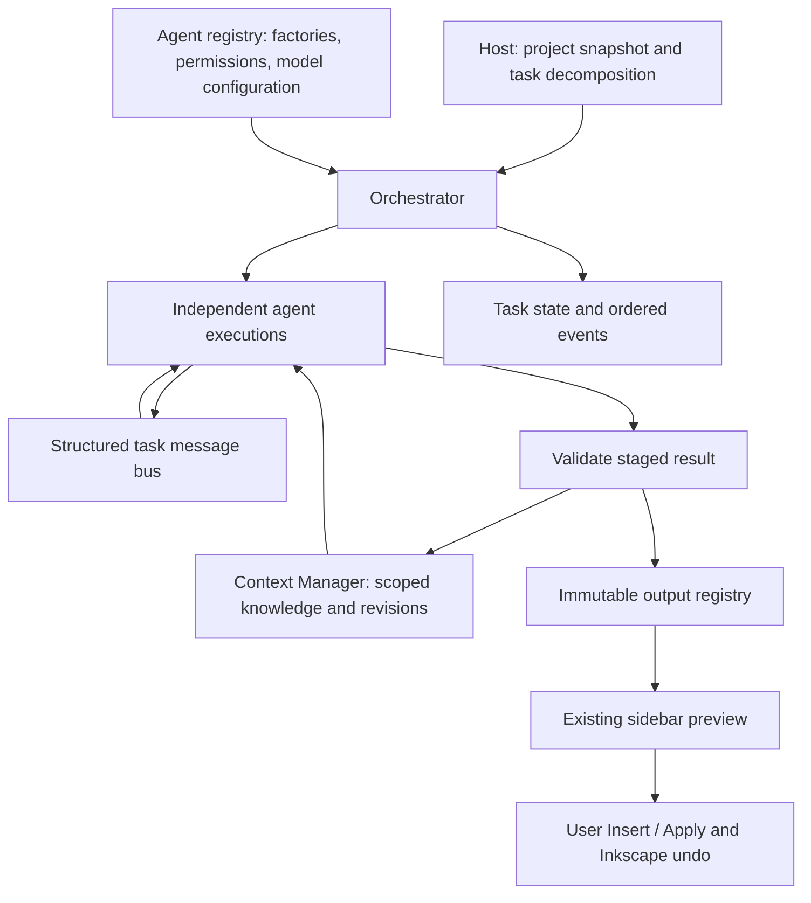

# Modular AI workflows

The infrastructure is in `src/ai`, under `Inkscape::AI`. The opt-in **Plan** sidebar mode registers Planner and Asset Discovery. The existing
creation, editing and command modes retain their own pipelines.

## Existing application and integration decisions

The application is C++20 with GTK4/gtkmm4. `src/ui/dialog/ai-assistant.cpp`
currently owns prompt construction, provider requests, proposal previews, and
user-confirmed application. Its modes use these existing components:

| Component | Existing role | Workflow integration |
| --- | --- | --- |
| `ai-codex` | Cancellable local CLI transport, using saved login | Can be injected into an agent; no scheduler dependency |
| `ai-connection` | Shared API / CLI requests and capabilities | Sidebar and agents share validation, cancellation and response normalization |
| `ai-conversation` | Per-document chat history, brief, drafts, accepted SVG | Remains separate from structured design context |
| `AIRegion`, `AIVectorEdit` | Snapshot-scoped geometry and region edits | Continue to own edit validation and geometry operations |
| `AIActions` | Allowlisted native document operations | Remains the command execution path |
| `SelectionEdit` | Freshness checks, preview documents, applying edits | Keeps existing canvas/undo responsibility |
| `validate_generated_svg` | Restricted generated SVG validation | Moved unchanged to `ai/svg-validation`; shared by sidebar and registry |
| `Async`, GLib tasks | Existing UI/background communication | A background owner runs workflows; GTK polls snapshots every 150 ms |

The workflow core links only existing nlohmann JSON, GLib, libxml2 and standard
C++ threading. It has no GTK, provider, or live `SPDocument` dependency. Its
separate library also allows headless testing without GoogleTest.



## Responsibilities

**Orchestrator** validates the dependency DAG, discovers compatible registered
agents, assigns tasks, schedules ready work, retries transient errors, and
collects results. It does not interpret design semantics or build model prompts.
A host-supplied `TaskDecomposer` converts a prompt and project snapshot into
`TaskSpec` records. The future Planner can instead publish child tasks through
`AgentResult::tasks` when registered with `can_decompose=true`. Every child
implicitly depends on its parent, and the entire expanded graph is validated
before its parent's result is committed. Registering a new agent does not
require scheduler changes.

**ContextManager** owns project knowledge. Agents receive filtered value copies,
not a mutable store. Context writes use exact keys and expected revisions. A
batch either commits in full with its outputs or publishes nothing. Agents
cannot overwrite another author's entry, even when they have permission to
write the project key. Cross-agent suggestions go through messages; the owner
or host decides whether to accept them.

**Agents** implement specialized work behind a common interface. Every attempt
uses a fresh factory-created instance with an ID, descriptor, capabilities,
input/output formats and execution status. `AgentRequest::model` holds a separate
provider/model/connection configuration. The connection is an opaque lookup ID;
credentials belong in a transport service, never context, task input, or events.
Factories can capture that service without changing the orchestrator.

## Register and run an agent

A minimal metadata agent looks like this (the executable test contains the two
more complete demonstration agents):

```cpp
#include "ai/orchestrator.h"
using namespace Inkscape::AI;

class ExampleAgent final : public Agent {
public:
    AgentDescriptor descriptor() const override {
        return {"example", "Example", "Reports canvas metadata", {"describe"},
                {"application/json"}, {"application/json"}, false};
    }
protected:
    AgentResult execute(AgentRequest const &request, ExecutionContext &execution) override {
        execution.checkpoint();
        auto canvas = request.context.get({Scope::Project, {}, "canvas"});
        OutputDraft output;
        output.name = "description";
        output.format = "application/json";
        output.kind = OutputKind::Metadata;
        output.data = canvas.dump();
        AgentResult result;
        result.outputs.push_back(output);
        result.context.push_back({{Scope::Task, request.context_task, "summary"},
                                  "Canvas dimensions inspected", 0});
        return result;
    }
};

auto agents = std::make_shared<AgentRegistry>();
agents->add([] { return std::make_unique<ExampleAgent>(); },
            ModelConfig{}, ContextAccess{{"canvas"}, {}});
auto context = std::make_shared<ContextManager>("stable-project-id");
context->set_project("canvas", {{"width", 800}, {"height", 600}, {"unit", "px"}});
auto outputs = std::make_shared<OutputRegistry>();
auto workflow = std::make_shared<Orchestrator>(agents, context, outputs, 4);
TaskSpec task;
task.id = "describe-canvas";
task.capability = "describe"; // Or set task.agent to a particular registered ID.
task.description = "Describe the current canvas";
auto completion = workflow->start("Inspect my design", std::vector<TaskSpec>{task});
```

Retain both the orchestrator and completion future. Poll `wait_for(0ms)` from
GTK, and call `get()` only when ready. Destruction of a `std::async` future may
wait for its work, so do not discard an unfinished future on the UI thread.
`cancel()` signals the coordinator, running agents and interruptible message
waits. Snapshots and message history are safe to read while work is running.

`TaskSpec` contains ID, optional assigned agent, capability, description,
structured input and input format, required output format, dependencies,
timeout and retry policy. The state path is Pending → Assigned → Running →
Completed/Failed. A transient failure returns to Assigned for another attempt;
events retain the attempt/error details. Only `AgentError` marked retryable is
retried. Invalid data, permissions and other exceptions fail without retrying.
Failed dependencies fail their downstream tasks; independent branches continue.
Cancellation uses Failed task records with `error_code=cancelled` and a Cancelled
workflow state. IDs are unique within a workflow; context task namespaces are
qualified by workflow UUID so repeated iterations do not collide.

## Project and task context

The host initializes project keys from the current document and design brief
on the GTK thread, before launching background work. The store accepts bounded
JSON values so the knowledge schema can grow without scheduler changes.
Recommended project keys are:

| Key | Content |
| --- | --- |
| `original_prompt` | Original request, recorded automatically at workflow start |
| `objectives` | Design objectives |
| `canvas` | Width, height, units and selected page identity |
| `style` | Visual direction / design brief |
| `palette` | Colour definitions |
| `typography` | Font and text requirements |
| `svg_elements` | Bounded element catalog copied from the document |
| `assets` | Accepted asset references, source URLs, attribution and licences |
| `decisions`, `constraints` | Accepted design decisions and restrictions |
| `iterations` | Bounded task/dependency/output/error summaries, recorded automatically |

Use `ContextAccess::read_project` and `write_project` to grant exact keys.
An agent also reads its own agent namespace, its own task namespace, and the
task namespaces of completed direct dependencies. It can write only its own
agent/task namespaces and explicitly granted project keys. Use
`request.context_task` as the owner of task-scoped patches. `outputs` and
`dependencies` in that namespace are reserved for the orchestrator.

`expected_revision=0` means create; updates must use the revision from the
snapshot. Concurrent updates cannot silently replace each other. Host-owned
project entries remain host-owned: agents publish proposals in their namespace,
and the host accepts appropriate changes with `set_project`. Only one workflow
may run against a ContextManager at a time; its internal tasks run concurrently.

After the completion future is ready, persist using:

```cpp
outputs->save(output_path, context->snapshot().project);
context->save(context_path);
```

Choose paths in the application's private project storage, keyed by a canonical
saved document identity (or an untitled-project UUID), and create the directory
before saving. Files use versioned JSON, atomic durable replacement and mode
0600. Save outputs first, then context: interruption between these saves leaves
extra unreferenced outputs rather than missing referenced outputs. Reload into
fresh services with the same project identity. Wrong-project, malformed,
oversized or unknown-version files are rejected without replacing in-memory
state. Registered format validators revalidate archived output bytes on load.
The host owns save/load timing; the sidebar adapter automatically saves completed
workflow sessions for saved documents, as described below. Running tasks are not resumed after
restart; saved iterations are design history, not execution checkpoints.

## Messages, outputs and canvas integration

`ExecutionContext::send` fixes the sender to the current task. Targets must be
registered task IDs or `host`. Supported messages are information/context
requests, asset references and suggestions. Payloads are structured JSON with
correlation IDs. Completion/failure is published by the orchestrator after
validation; an agent cannot declare itself successfully integrated.
`receive(after_sequence, wait)` reads only the task's inbox and obeys the task's
deadline and stop token. Prefer dependency outputs for normal hand-offs; messages
are for additional coordination. Avoid waiting for a task that cannot yet be
scheduled (a dependent task, or a peer when all slots are occupied). Timeouts
bound such mistakes. Retry messages retain attempt correlation IDs so recipients
can distinguish repeated requests.

Outputs carry immutable workflow/task/agent identity, names, formats, kinds,
source attribution/licence and parent output IDs. Agents can reference only
outputs of their completed direct dependencies. Registry kinds include SVG,
SVG components, raster images, retrieved assets, metadata, intermediate outputs
and final compositions. SVG components use a complete SVG wrapper so the shared
validator can check them. SVG, JSON and UTF-8 text have built-in validators.
Additional image/asset formats must register a host-side decoder/validator first;
unknown formats fail closed. Source URLs are provenance, never automatic fetch
instructions. The registry never writes arbitrary agent-supplied file paths.

On the GTK thread, integrations with final SVG registry outputs can call:

```cpp
assistant.preview_workflow_output(*outputs, final_output_id);
```

This bridge revalidates SVG, creates the existing temporary preview and exposes
Insert. It does not mutate the canvas. Insertion retains existing visible-bounds
checks, importer, editable grouping and Undo. Metadata/raster outputs cannot
enter this SVG preview route. The host must route the result back to the owning
project, and must still use existing snapshot/freshness validation for future
agents that propose edits to existing objects. The current bridge adds new
compositions; it is not a bypass for geometry edits or command execution.

## Execution visibility and limits

`WorkflowSnapshot` includes workflow state, task records, assignments,
dependencies, output references, attempt counts and errors. Ordered events have
monotonic sequence numbers (`task-added`, `task-assigned`, `task-running`,
`task-retry`, `task-completed`, `task-failed`, and workflow lifecycle events).
An execution panel can derive active agents and responsibilities from running
tasks. `progress()` is the fraction of terminal tasks; the denominator can grow
when decomposition adds tasks. The last 4096 events are retained. No elaborate
dashboard or polling LLM calls are required.

Defaults/limits: 4 concurrent tasks (configurable 1–16), 128 tasks per workflow,
1 attempt by default (maximum 5), exponential retry delay, a 120-second default
task deadline (maximum 30 minutes), 64 messages per task / 4096 per workflow,
8 KiB message payloads, 32 outputs per task, a 32 MiB decoded output registry,
8 MiB context storage and 4096 context entries. Long-lived projects should
archive/reset completed workflow data before these explicit limits are reached.

Cancellation and deadlines are cooperative for in-process C++ agents. Agents
must call `checkpoint()` and connect the stop token to blocking transports.
An existing local Codex transport can use a `std::stop_callback` to call
`g_cancellable_cancel` on its `GCancellable`; HTTP adapters need equivalent
cancellation and request timeouts. Late results are rejected even if an agent
misses its deadline. The scheduler never detaches an unsafe worker or retries it
while its previous attempt is still running. It cannot forcibly terminate
arbitrary C++ code that ignores cancellation; use a supervised subprocess for
such work. Factories/decomposition policies/validators are trusted application
code, not a sandbox for untrusted native plugins. Do not perform model calls
inside the decomposition callback; use a registered decomposing agent instead.

## Build, demonstration and regression tests

```sh
cmake --build build --target test_ai_workflow inkscape -j2
build/bin/test_ai_workflow /tmp/ai-workflow-demo.svg
```

The two test agents live only in `testfiles/src/ai-workflow-test.cpp`:

- TileAgent generates deterministic coloured rectangles and JSON metadata. Two
  instances run concurrently and exchange an information request and suggestion.
- AssemblyAgent consumes their validated dependency outputs and creates one SVG
  composition with parent provenance.

The test demonstrates capability assignment, two parallel tasks, a dependent
composition and five outputs. It additionally exercises scoped reads/writes,
revision conflicts, atomic rejection, duplicate/unknown agents and task IDs,
cycles, invalid SVG, retries, dependency failure, cancellation, late results,
dynamic child tasks, event order and durable context/output round trips.
It needs no network, model credentials, GUI, or GoogleTest. With GoogleTest
available in the project, it also joins the existing `tests`/CTest target.

## Planner and Asset Discovery in the sidebar

1. Open AI Assistant and choose a [model connection](ai-connections.md).
2. Select **Plan**, enter the design request and optionally a design brief,
   then send. The selected page dimensions are included; existing artwork and
   image attachments are not inputs to this mode.
3. Review the plan, task progress, image thumbnails and linked sources. Select
   **Include in drawing** for the assets to use (up to eight). Each thumbnail
   identifies an editable SVG or an embedded image. Stop cancels the active
   workflow and pending downloads. Failed searches leave a completed plan available, with the
   failure shown alongside it.
4. Optionally type a refinement, then click **Create preview**. This uses the
   existing SVG generation/validation path. Review the result and click **Insert**
   to place it on the canvas; the normal Undo action remains available.

`PlannerAgent` validates a structured brief, palette, layout and zero to three
asset queries. Only host code converts queries into TaskSpecs; the model cannot
invent agent IDs or execution settings. Independent queries run concurrently,
with at most three workers. `AssetDiscoveryAgent` searches Wikimedia Commons,
then asks the configured model to select at most three candidates per query by
index. Unknown, duplicate, negative and oversized indices are rejected. Both
agents currently use the sidebar's configured model; their separate registry
ModelConfigs and injected transports support other configurations without
scheduler changes.

Commons receives the generated search queries, not the full prompt. The model
receives bounded candidate metadata. Sources and licensing are copied from the
actual search results, never generated by the model. The adapter uses the
[Imageinfo API](https://www.mediawiki.org/wiki/API:Imageinfo) and normalizes
[Commons machine-readable metadata](https://commons.wikimedia.org/wiki/Commons:Machine-readable_data)
to plain text. Missing licensing or attribution is displayed explicitly.

Discovered images are downloaded from allowlisted Wikimedia upload/thumbnail URLs, with
redirects disabled, cancellation, a shared 90-second preparation deadline and a
4 MB per-download limit. Imageinfo analytics query parameters are removed. The model cannot supply a download URL. SVGs are parsed
without network access, safe inline styles are converted to presentation
attributes, and the existing strict SVG validator checks the result. Unsupported
SVGs use Commons' raster rendition and are labeled **Embedded image**. Failed
assets show their error and cannot be selected; the plan remains usable.

Thumbnails and embedded bitmap renditions are normalized to PNG at up to 800
pixels on the longest side, with dimension and byte limits. Compatible SVGs
retain their vector paths. **Create preview** sends selected image previews,
asset IDs and the plan to the configured vision-capable model. The model emits
an SVG layout containing a rectangle for each selected asset. Host code checks
these placeholders, inserts the actual prepared vectors or embedded PNG pixels,
retains source/licence/attribution in SVG descriptions, then displays the composed
preview. Missing or duplicate placeholders reject the preview. No canvas change
occurs until **Insert**; the existing importer and Undo/Redo remain in use.

External images and arbitrary URLs remain prohibited in ordinary model SVG.
Only exact bytes assembled locally from validated layouts and prepared downloads
can use the asset preview/import path. A separate Composition agent is not yet
implemented. Downloaded bytes are session-local; after insertion, saving the
Inkscape SVG keeps them embedded and portable. Large compositions are omitted
from the bounded chat artwork archive without blocking preview or insertion.
Inspect linked source pages for usage terms before publishing external assets.

`ai-design-services` uses the shared `ai-connection` transport for model requests,
propagates cancellation and bounds response sizes and task deadlines. Credentials
stay in transport closures, outside persisted context and model configurations.
`DesignRun` owns the background completion future so closing the panel never
waits for a worker on the GTK thread. Document changes cancel the workflow and
invalidate its UI results. Progress and results are rendered by
`ai-assistant-workflow.cpp`; agents never receive a live document or widget.

For saved documents, context and outputs use the canonical document identity
and the existing conversation storage prefix, with `.workflow.context.json` and
`.workflow.outputs.json` suffixes. Unsaved documents have ephemeral sessions.
Damaged archives are preserved and reported; the current run can still finish.
Within one application process, simultaneous workflows for the same storage
path cannot replace each other's archives: the second run keeps its results in
memory and reports that they were not saved.
Stored history is not automatically reopened as a pending sidebar proposal.

Production-agent and background-service tests use injected model/search fixtures
and make no provider calls:

```sh
cmake --build build --target test_ai_design_agents test_ai_design_services test_ai_design_assets inkscape -j2
build/bin/test_ai_design_agents
build/bin/test_ai_design_services
build/bin/test_ai_design_assets
# Optional live public Commons request, without model credentials:
build/bin/test_ai_design_services --live-search
# Download, normalize and compose one real asset:
build/bin/test_ai_design_services --live-assets
```

These cover decomposition, provenance, malformed responses, metadata validation,
empty results, partial failures, cancellation, persistence, archive corruption
and endpoint checks. The native sidebar smoke test also renders completed plans
image thumbnails, inclusion controls and long source links at narrow widths.
Asset tests check sanitization, fallback decoding, exact pixels in the final
composition, import, save/reload and Undo/Redo.

## Constraint-aware section layout

Plan mode now runs a deterministic layout CSP after validating the model's
section descriptions. `ai/layout-search` implements depth-first backtracking,
minimum-remaining-values (MRV) variable ordering and forward checking. The
model does not implement this search: it supplies the semantic plan, while the
host solver assigns geometry.

Each section is a variable. Its domain contains candidate rectangles on a
normalized 100 × 100 page. The first section is a full-width header; remaining
sections use a two-column, four-row grid in row-major preference order. These
are host layout defaults, not inferred user constraints or text-size estimates.
All boxes stay within a 5% margin and have at least 3% separation on one axis.
Alignment is encoded in the candidate grid. Up to eight sections are supported.
The generic solver also accepts other finite rectangle domains.

The initial state has no assigned rectangles. An action assigns one admissible
rectangle to the unassigned section with the smallest remaining domain. Forward
checking removes overlapping candidates from other domains. Empty domains cause
backtracking; a complete compatible assignment is the goal state. The solver
returns the first feasible assignment, not a globally optimal aesthetic layout.
Search stops after a configurable node budget and distinguishes exhaustion from
proven unsatisfiability. Workflow cancellation and deadlines are checked through
the execution checkpoint callback.

Each section receives `box_percent`; `layout_search` records status, algorithm,
visited candidates, backtracks and pruned candidates. These travel through the
existing JSON output/context storage into both preview generation routes. The
sidebar confirms the section arrangement. Generation is instructed to scale
rectangles to the page and keep content inside them. **Only the planned boxes
are guaranteed to satisfy this CSP.** Generated SVG content is not checked for
containment in those boxes; overflowing text and model deviations still require
preview review. Refinements that change the layout require running Plan again.

Run the offline solver and production Planner tests:

```sh
cmake --build build --target test_ai_layout_search test_ai_design_agents -j2
build/bin/test_ai_layout_search
build/bin/test_ai_design_agents
```

See [AI report evidence](ai-report-evidence.md) for the rubric mapping and limits.
