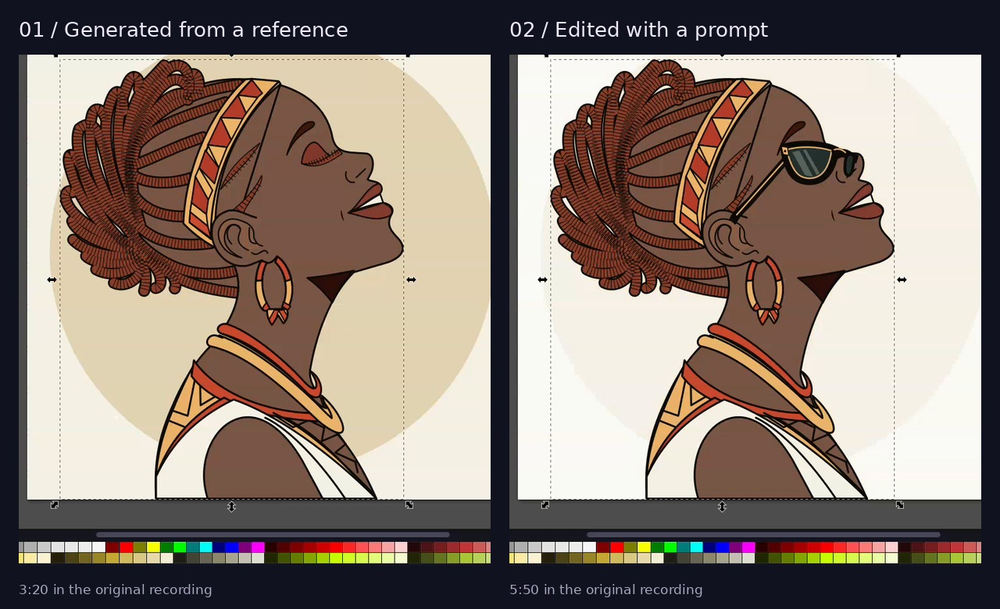

# WinkSpace 0.1.0 Beta 1

AI-assisted SVG creation and editing, built on Inkscape. This first Linux beta
includes the vector editor, integrated assistant, and generation inside closed
shapes.



[Watch or download the full demo (MP4, 6:29)](https://github.com/Namandeepsd/winksopac/releases/download/v0.1.0-beta.1/winkspace-demo.mp4)
· [Project README](https://github.com/Namandeepsd/winksopac/tree/v0.1.0-beta.1#readme)
· [Model connections](https://github.com/Namandeepsd/winksopac/blob/v0.1.0-beta.1/doc/ai-connections.md)

## Install on Linux

**Built and tested on Ubuntu 25.10, amd64/x86_64, with GTK4.**
Download `winkspace_0.1.0-beta.1_amd64.deb`, open a terminal in its directory, and run:

```sh
sudo apt install ./winkspace_0.1.0-beta.1_amd64.deb
winkspace
```

APT installs the declared dependencies. The package installs into `/opt/winkspace`
and adds an application launcher. Configure a model in **AI Assistant → Connection
settings** before using generation.

For an extracted-folder launch, use the Linux `.tar.xz` asset and its included
README. The `.deb` is recommended for dependency installation and desktop
integration. These are native builds; compatibility with older Ubuntu releases
and other distributions has not been established.

## Included downloads

- **Debian package** and **Linux archive**, about 21 MiB each.
- **Complete corresponding source**, including nested submodules and build scripts.
- **Original demo recording**, showing reference-based generation, an edit that
  adds sunglasses, and individual paths in the object tree.
- **BUILD-INFO.json**, identifying the build platform and exact source revisions.
- **SHA256SUMS**, for verifying downloaded assets.

The automatically generated GitHub source archives omit submodule contents.
Use the attached `WinkSpace-0.1.0-beta.1-source.tar.xz` for complete source.

## Verification and beta notes

The release was checked with a Release build, package metadata and APT dependency
resolution, relocated launches and SVG-to-PNG exports from both binary formats,
and the assistant's isolated GUI smoke test. Source contents and download
checksums were also verified. Model providers were not called by these checks.

Generation quality and request duration depend on the selected model. Artwork
requests can take several minutes; the connection settings expose a request time
limit. The recording predates this packaging release, so some interface details
can differ. Current Inkscape-format preferences are shared unless you set an
independent `INKSCAPE_PROFILE_DIR`.

WinkSpace is an independent modified distribution of Inkscape. The combined
application is GPL-3.0-or-later, with upstream credits and component notices
retained in the package and corresponding source. See **Help → About WinkSpace**
and `WINKSPACE-NOTICES.txt`.
